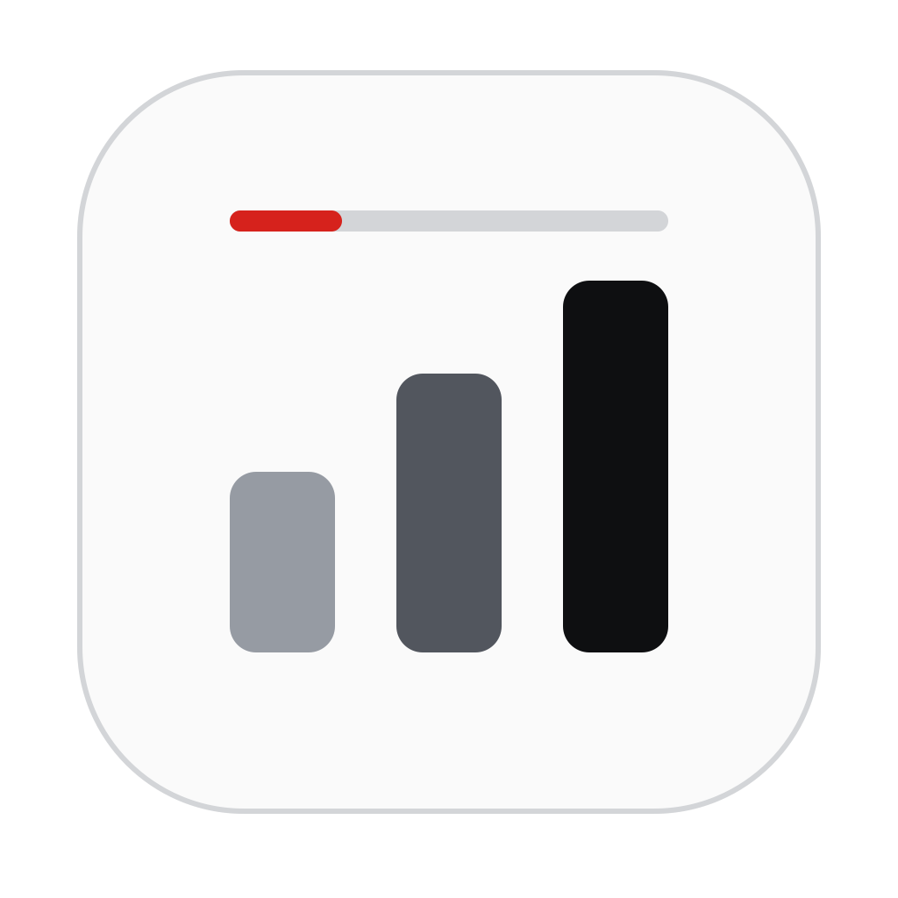
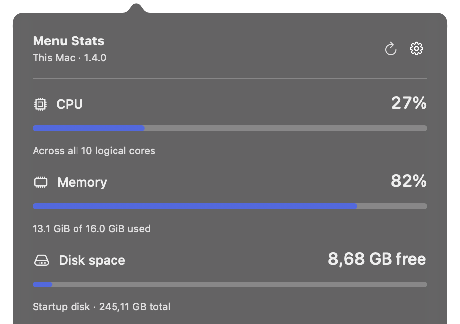
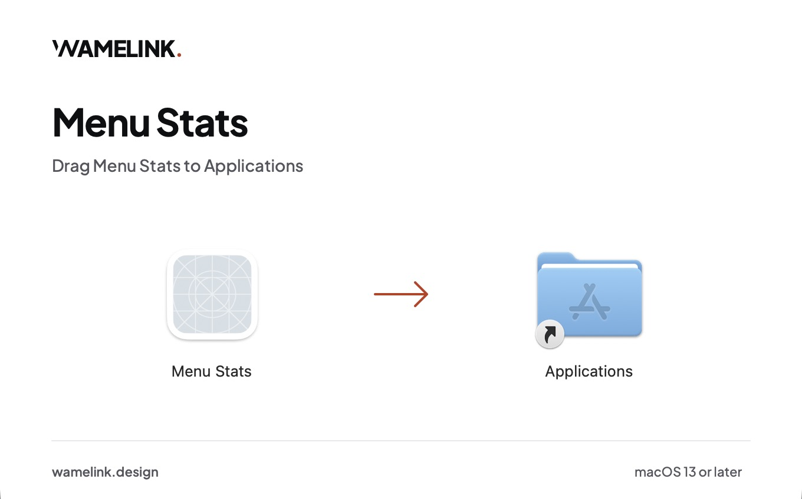
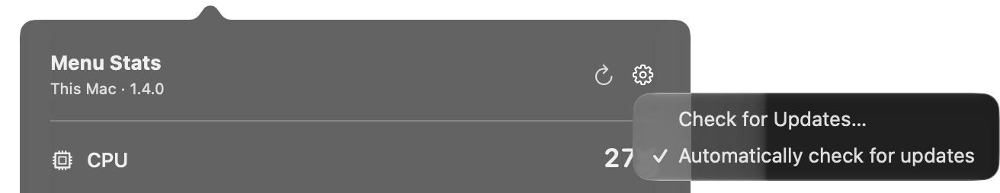
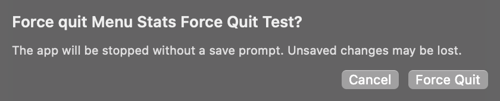

# Menu Stats

A small native macOS app that puts CPU usage, memory usage, and free startup disk space in your menu bar. Click it to see which apps are using the most resources, quit an app normally, or force quit one that will not close.

## Download and install

**[Download Menu Stats 1.4.0 for macOS](https://github.com/wamelinkwebdesign/mac-menu-stats/releases/download/v1.4.0/Menu-Stats-1.4.0-universal.dmg)** ([ZIP](https://github.com/wamelinkwebdesign/mac-menu-stats/releases/download/v1.4.0/Menu-Stats-1.4.0-universal.zip), [all releases](https://github.com/wamelinkwebdesign/mac-menu-stats/releases))

Requires macOS 13 or later. One universal build for Apple silicon and Intel, signed and notarized by Apple.

1. Open the DMG and drag **Menu Stats** onto **Applications**.
2. Open **Menu Stats** from Applications. Its readings appear in the menu bar.
3. Optional: add it under **System Settings > General > Login Items & Extensions > Open at Login** to start it automatically.

## Features

- CPU, RAM, and free disk space at a glance, without a Dock icon.
- A live top-five list of apps, ranked by CPU or memory.
- Quit an app, or force quit it after a separate confirmation.
- Refresh every 1, 2, or 5 seconds, with a shortcut to Activity Monitor.
- Light and dark appearance, following your system.
- In-app updates, installed only with your approval.
- No telemetry: readings stay on your Mac.

## Updates

Open the gear menu in the panel and choose **Check for Updates…**. Menu Stats downloads, verifies and installs the new version, then reopens. It also checks automatically about once a day; you can turn that off in the same menu.

**Using 1.3.2 or earlier?** Install 1.4.0 once from the download above. Later versions update from within the app.

## Quitting apps

Click **Quit** beside an app and confirm. The app can still ask you to save your work. If it will not close, choose **Force Quit…**: a second confirmation warns that unsaved changes may be lost. Force Quit never happens automatically.

## Privacy

CPU, memory, disk, and app readings are never uploaded. The only network traffic is the update check against a signed feed on GitHub, and downloads you approve from GitHub Releases. The app asks for no extra permissions.

## Development

Build from source, how each reading is calculated, and the release process: see [docs/DEVELOPMENT.md](docs/DEVELOPMENT.md).
