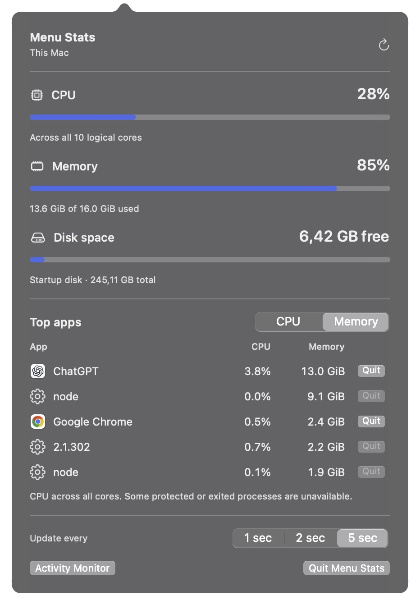
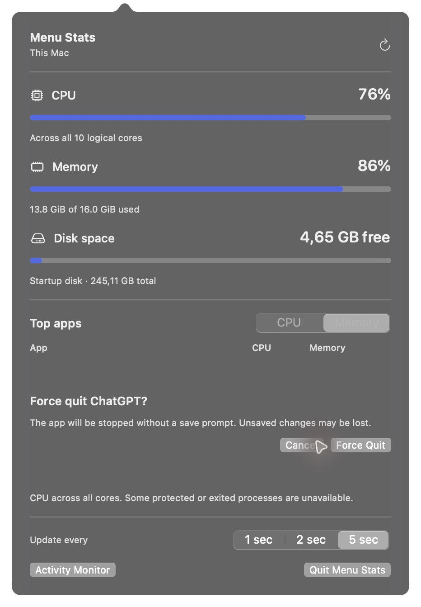

# Menu Stats

A small native macOS app that puts CPU usage, memory usage, and free startup disk space in your menu bar. Click it to see which apps are using the most resources, quit an app normally, or force quit one that will not close.



## Download and install

**[Download Menu Stats 1.3.1 for macOS](https://github.com/wamelinkwebdesign/mac-menu-stats/releases/download/v1.3.1/Menu-Stats-1.3.1-universal.zip)**

Requires macOS 13 or later. One universal download includes Apple silicon and Intel builds. No Xcode or Swift installation is needed to use it.

1. Download and unzip the file.
2. Drag **Menu Stats.app** into **Applications**. Quit an older copy before replacing it.
3. Open **Menu Stats** from Applications. Its CPU, RAM, and disk readings appear in the menu bar.
4. To start it automatically, add the installed app under **System Settings > General > Login Items & Extensions > Open at Login**.

The download is signed with an Apple Developer ID certificate and **notarized by Apple**. Its notarization ticket is stapled to the app. macOS may still ask you to confirm that you want to open an app downloaded from the internet.

See [all releases](https://github.com/wamelinkwebdesign/mac-menu-stats/releases) for release notes and SHA-256 checksums. The current build was run on Apple silicon; the Intel slice is included and signature-checked, but has not been run on an Intel Mac.

## Features

- CPU, RAM, and free disk space at a glance, without a Dock icon.
- A live top-five list ranked by CPU or memory, with app icons and usage readings.
- Normal Quit and a separate, explicitly confirmed Force Quit action for desktop apps.
- Refresh every 1, 2, or 5 seconds, plus a manual refresh button and a shortcut to Activity Monitor.
- Native SwiftUI and AppKit controls with system light and dark appearance.
- Local system APIs, no package dependencies, network access, telemetry, or privileged helpers.

## Requirements

- **To run:** macOS 13 Ventura or later.
- **To build:** a Swift 6 or newer compiler and the macOS SDK, available through a compatible Xcode or Command Line Tools installation.

Building from source is optional. The commands below produce a locally signed debug app. The downloadable release above uses an optimized universal build signed with Developer ID.

## Build from source

Clone into a local development folder outside cloud-managed Documents folders, then build:

```sh
git clone https://github.com/wamelinkwebdesign/mac-menu-stats.git
cd mac-menu-stats
bash scripts/build-app.sh
```

The script creates `outputs/Menu Stats.app` and verifies its ad-hoc code signature. It finishes building before replacing an existing Menu Stats bundle in the output folder. To choose another output folder, pass its path as the first argument.

Open the output folder in Finder:

```sh
open outputs
```

Drag **Menu Stats.app** into **Applications**, then open the installed copy:

```sh
open "/Applications/Menu Stats.app"
```

The app appears in the menu bar. If the menu bar is crowded, macOS may hide its item until more space is available. When updating an installed copy, quit Menu Stats before replacing it in Applications.

### Start automatically at login

1. Install the app in Applications first.
2. Open **System Settings > General > Login Items & Extensions**. On some macOS versions, this page is named **Login Items**.
3. Under **Open at Login**, click **+** and select **Menu Stats** from Applications.

macOS will open that installed copy when you sign in. The app does not register itself automatically. Keep the app in Applications so the login item continues to point to the installed copy.

## Use the app

Click the CPU, RAM, and free disk text in the menu bar to open the panel. Choose **CPU** or **Memory** above the Top apps list to change its ranking. The default refresh interval is two seconds; your choice is saved locally.

CPU readings need two samples. The panel briefly shows a measuring state after opening, then updates the list. Detailed process sampling runs only while the panel is open.

### Quit an app

Click **Quit** beside a desktop app and review its name before confirming. Normal Quit lets the app show a save dialog or decline to exit.

If normal Quit does not work, choose **Force Quit…** in the confirmation panel. A second confirmation warns that unsaved changes may be lost. Force Quit never runs automatically after a normal quit request fails.



*The screenshot shows the separate Force Quit warning. This preview was cancelled without quitting the selected app.*

The selected app stays fixed while the live rankings change. Closing the panel or choosing Cancel dismisses a pending confirmation. Feedback reports a quit request, not a guaranteed completed exit.

Quit actions are disabled for background processes, apps without a verifiable running identity, and Menu Stats itself. Use **Quit Menu Stats** at the bottom to close this utility. App actions target the selected desktop app instances, so separately running helpers may remain in the statistics.

## What the readings mean

Menu Stats and Activity Monitor may show different values because they use different definitions and sampling intervals.

| Reading | Definition |
| --- | --- |
| System CPU | The change in user, system, and nice CPU ticks divided by the change in all ticks, including idle. Usage across all cores is shown on a 0 to 100% scale. |
| System memory | An estimate of physical memory used: anonymous resident pages minus purgeable pages, plus wired pages and the compressor's physical storage. File-backed cache is excluded. This percentage is not memory pressure. |
| Free disk space | Space currently available to the user on `/System/Volumes/Data`, using `statfs.f_bavail` times the block size. Purgeable capacity that Finder may include is excluded. APFS volumes share container space. |
| App CPU | Interval CPU time divided by elapsed time and the logical core count, using Mach absolute-time ticks. It uses the same whole-machine scale as the menu bar. Activity Monitor commonly uses 100% per core, so its percentages can be higher. |
| App memory | The physical footprint reported by `proc_pid_rusage`, including compressed memory. These figures do not sum directly to the system memory estimate. |

Memory uses binary GiB, where 1 GiB is 1,073,741,824 bytes. Total memory is the installed physical memory reported by macOS. Disk capacity uses decimal GB/TB, where 1 GB is 1,000,000,000 bytes; total capacity comes from the same startup data volume.

Helpers inside an app bundle are grouped under the outermost app. Standalone background processes are also listed. Unrelated processes are not merged simply because their names match.

Unavailable readings are shown as unknown, never as zero. Protected or exited processes may be unavailable, and the panel indicates partial coverage. A fresh app CPU baseline is collected whenever the panel opens, followed by a second sample after one second and then the chosen refresh interval.

## Privacy and app control

Resource collection stays on your Mac and uses system APIs rather than shell commands. The app asks for no additional permissions.

Normal Quit and Force Quit use `NSRunningApplication`. Each request rechecks the originally selected application instance, including its identity and lifetime. It never substitutes a newly launched app or a process that reused the selected app's PID. There is no raw PID signaling, shell-based process killing, or elevated access.

## Development and verification

```sh
swift test
swift build
swift run MenuStatsProbe
swift run MenuStatsProbe --apps
bash scripts/build-app.sh
open "outputs/Menu Stats.app" --args --show
```

The probe prints two real samples as JSON, one second apart, without opening the UI. Its first CPU reading is absent while the sampler establishes a baseline. It exits with a failure status if the second sample has missing metrics or errors. `--apps` selects app/process readings and fails on enumeration errors or missing usable CPU readings.

For a native smoke check, confirm that menu bar values update, inspect both app rankings, close and reopen the panel, change the refresh interval, and open Activity Monitor. Validate Cancel, normal Quit, and Force Quit with a disposable test application that refuses normal termination. Do not use an app containing unsaved work for this check. The running app is the interactive preview; no browser or development server is needed.

| Component | Responsibility |
| --- | --- |
| `MenuStatsCore` | System and app sampling, grouping, and metric calculations. |
| `MenuStatsAppControl` | Verified normal and force quit requests. |
| `MenuStats` | Native menu bar interface and panel. |
| `MenuStatsProbe` | Command-line probes for live readings. |
| `CProcessStats` | C bridge to macOS process APIs. |

Generated app bundles, work files, and Swift build artifacts are kept out of git.

### Build a release bundle

```sh
CODE_SIGN_IDENTITY="Developer ID Application: Your Name (TEAMID)" bash scripts/build-release.sh
```

This creates `outputs/release/Menu Stats.app` with optimized Apple silicon and Intel executables and validates its signature. Signing with Developer ID enables the hardened runtime and a secure timestamp. Without `CODE_SIGN_IDENTITY`, the script creates an explicitly ad-hoc signed local build. The script does not notarize or upload the app.
